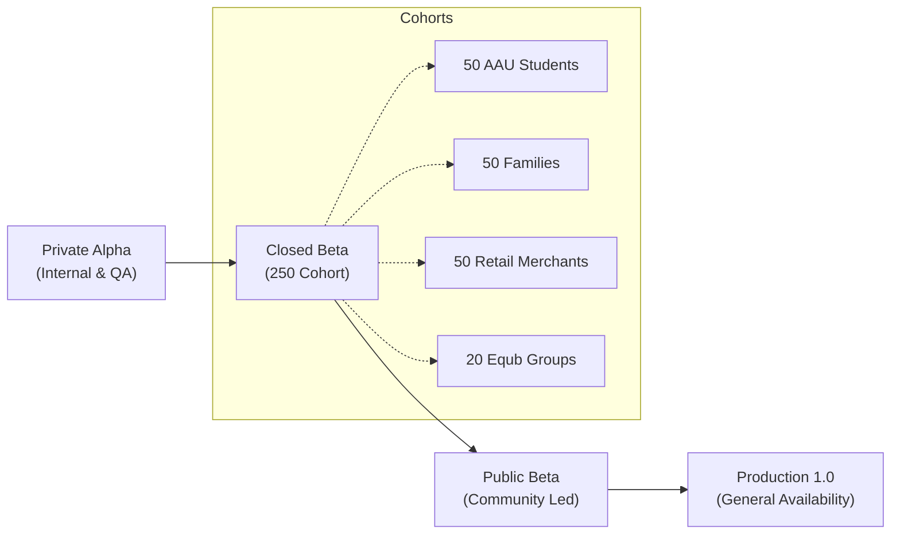

# DailySave Launch Strategy, Organic Growth Plan, and Marketing Collateral

**Document Version:** 1.0.0  
**Target Markets:** Ethiopia (Primary: Addis Ababa, Hawassa, Adama, Bahir Dar, Jimma, Mekelle) & East African Diaspora  
**Languages Supported:** English, Amharic (አማርኛ), Afaan Oromo (Oromoo)  
**Growth Philosophy:** Community-first, educational, zero-burn organic expansion (no reliance on unsustainable paid advertising).  

---

## 1. Executive Launch Philosophy

DailySave is built for everyday financial reality in Ethiopia and emerging economies: cash wallets, mobile money (Telebirr, CBE Birr), intermittent internet connectivity, and traditional community savings circles (Equb / ዕቁብ).

Our go-to-market strategy avoids speculative vanity metrics and paid ad burn. Instead, it relies on:
1. **Utility-First Value:** Solving real cash-leakage and savings tracking problems immediately without requiring credit cards or signups to test.
2. **Community Ground Game:** Direct engagement with university students, campus unions, SACCOs, and local business associations.
3. **Multilingual Authenticity:** Native support for Amharic and Afaan Oromo with full Ge'ez calendar integration (13 months).
4. **Privacy Advocacy:** Zero personal data selling, client-side encryption, and offline-first autonomy.

---

## 2. Phased Rollout Roadmap



### Phase 1: University Campus Pilots (Month 1)
- **Campuses:** Addis Ababa University (AAU Sidist Kilo, 4 Kilo, 5 Kilo), Adama Science and Technology University (ASTU), Hawassa University.
- **Focus Cohort:** Undergraduates managing monthly family allowances, dormitory expenses, cafeteria budgeting, and group study costs.
- **Delivery:** Campus student union Telegram channels, dorm flyers with offline PWA QR codes, peer demo tables.

### Phase 2: Community Savings Groups (Equbs) & Families (Month 2)
- **Focus Cohort:** Neighborhood Equb treasurers, church/mosque social funds, household budget managers.
- **Delivery:** Direct outreach to Equb treasurers demonstrating the transparent shared contribution schedule, automated PDF report generation, and multi-member audit trails.

### Phase 3: Small Merchants & Merkato Retailers (Month 3)
- **Focus Cohort:** Retail shop owners, kiosk operators, market vendors reconciling physical cash boxes with incoming Telebirr/CBE transfers at the end of each business day.
- **Delivery:** Merchant association partnerships, cash-flow ledger templates, one-tap daily net revenue reporting.

### Phase 4: Regional & Diaspora Expansion (Months 4–6)
- Integration with regional mobile wallets across East Africa (M-Pesa, Airtel Money) and diaspora family remittance tracking.

---

## 3. Official Press Release

### English
**FOR IMMEDIATE RELEASE**  
**DailySave Launches Ethiopia’s First Offline-First Financial Platform with Native Ge’ez Calendar and Equb Community Support**  
*Addis Ababa, Ethiopia — November 2026*  

DailySave (የዕለት ቁጠባ) today announced the general public release of its privacy-first personal and community finance platform. Engineered specifically for the Ethiopian economic ecosystem, DailySave empowers students, families, small businesses, and community savings groups to track cash, mobile money (Telebirr, CBE), and joint budgets with complete offline reliability.

Unlike conventional cloud-only financial software that fails when connectivity drops, DailySave functions 100% offline using a secure local database, seamlessly synchronizing data whenever internet access is restored. DailySave is also the first platform to offer seamless switching between the 13-month Ethiopian Ge'ez calendar and the Gregorian calendar, alongside native interfaces in English, Amharic, and Afaan Oromo.

"Financial freedom begins with knowing where every Birr goes," said the DailySave core team. "DailySave was engineered from day one to honor our cultural financial traditions—like Equb—while providing modern 64-bit integer precision and absolute data privacy."

DailySave is accessible today as an installable Progressive Web App (PWA) at `https://app.dailysave.et` and via offline mobile binaries.

---

### Amharic (አማርኛ)
**ለአፋጣኝ መግለጫ**  
**ዴይሊሴቭ (DailySave) — የኢትዮጵያን የዕቁብ ባህል እና የዘመናዊ ግዕዝ አቆጣጠርን ያካተተ የመጀመሪያው ከመስመር ውጭ የሚሰራ የፋይናንስ መተግበሪያ ይፋ ሆነ**  
*አዲስ አበባ፣ ኢትዮጵያ — ኅዳር 2019 ዓ.ም.*  

ዴይሊሴቭ (የዕለት ቁጠባ) የኢትዮጵያን ማህበረሰብ የፋይናንስ እንቅስቃሴ ያማከለ፣ ከኢንተርኔት መስመር ውጭ (Offline) ሙሉ በሙሉ የሚሰራ ዘመናዊ የፋይናንስና የዕቁብ መከታተያ መተግበሪያውን በይፋ አስመርቋል።

መተግበሪያው ተማሪዎች፣ ቤተሰቦች፣ አነስተኛ ነጋዴዎች እና የዕቁብ ሰብሳቢዎች የጥሬ ገንዘብ (ካሽ) እንዲሁም የቴሌብር እና የባንክ ሂሳቦቻቸውን በቀላሉ እንዲመዘግቡ ያስችላቸዋል። የ13ቱን ወራት የኢትዮጵያ አቆጣጠር (ግዕዝ) በሙሉ አቅም የሚደግፍ ሲሆን፣ መረጃዎ በስልክዎ ላይ በከፍተኛ ሚስጥራዊነት ብቻ እንዲቀመጥ ተደርጎ የተገነባ ነው።

"እያንዳንዱን ሳንቲም ማወቅ የፋይናንስ ነፃነት መጀመሪያ ነው" — ዴይሊሴቭን ዛሬውኑ በድረ-ገጽ እና በስልክዎ ይጠቀሙ።

---

### Afaan Oromoo (Oromo)
**Ibsa Murtii Hatattamaa**  
**DailySave (Qusannaa Guyyaa): Appilikeeshinii Faayinaansii fi Qusannaa Waloo (Iddirii fi Equb) Yeroo Jalqabaatiif Toora Interneetii Malee Hojjetu Ifatti Eebbifame**  
*Finfinnee, Itoophiyaa — Sadaasa 2026*  

DailySave namoota dhuunfaa, maatii, daldaltoota xixiqqaa fi gareewwan qusannaa waloo (Iqubii) Itoophiyaa keessatti argamaniif haala qabatamaa jireenya isaaniitiin kan walsimu appilikeeshinii faayinaansii toora interneetii malee guutummaatti hojjetu ifatti eebbiseera.

Appilikeeshiniin kun herrega Telebirr, Baankii Daldala Itoophiyaa (CBE) fi maallaqa harkaa tokkoon tokkoon hordofuuf kan gargaaru yoo ta'u, lakkoofsa guyyoota Itoophiyaa (Waggaa ji'oota 13) fi Afaan Oromoo dabalatee afaanota gurguddoo biyyattii ni deeggara.

---

## 4. Launch Announcement & Social Media Broadcast Copy

### Telegram Broadcast (English & Amharic)
```markdown
🚀 Welcome to DailySave (የዕለት ቁጠባ) — Take Control of Your Money! 🇪🇹

Tired of wondering where your Telebirr and cash disappear by the middle of the month?
Meet DailySave — the offline-first personal and community finance app built for Ethiopia.

✨ Why you will love DailySave:
• 📱 100% Offline: Works anywhere, anytime. No internet required.
• 📅 Ethiopian Ge'ez Calendar: Native 13-month calendar support.
• 🤝 Equb & Shared Groups: Track group savings, turns, and expenses transparently.
• 🔒 Absolute Privacy: Your money data belongs to you. Zero tracking or data selling.
• 🌐 Multilingual: English, አማርኛ, and Afaan Oromoo.

Try it now without installing any bulky APKs:
👉 https://app.dailysave.et

Join the community discussion: @DailySaveCommunity
#DailySave #EthiopianFinance #Telebirr #Equb #SmartSavings
```

### X / Twitter Launch Thread
```markdown
1/7 🧵 Introducing DailySave (የዕለት ቁጠባ) — the open, offline-first personal finance platform built for the Ethiopian economic reality. 🇪🇹

Here is why existing finance apps fail in Addis Ababa, Hawassa, and Dire Dawa, and how we fixed it 👇

2/7 Most international finance apps require:
❌ High-speed internet 24/7
❌ Gregorian calendar only (ignoring Pagume!)
❌ Credit cards instead of Telebirr/CBE
❌ Monthly USD subscriptions

3/7 DailySave is different:
✅ Works completely offline with local SQLite storage
✅ Full Ethiopian Ge'ez calendar (Meskerem to Pagume)
✅ Telebirr, CBE Birr, and physical cash wallet support
✅ Native Equb (ዕቁብ) group ledger and contributor tracking

4/7 Built with Flutter Web and Native Node.js HTTP microservices.
Zero heavy frameworks. 100% WCAG 2.2 AA accessible. 64-bit integer minor currency precision.

5/7 We respect your data:
• No ambient location tracking
• No advertising SDKs
• Fictional demo mode to explore safely before entering real transactions
• Privacy-gated AI assistant (opt-in only)

6/7 Try DailySave today on Web, Android, and Desktop:
🌐 https://app.dailysave.et
📚 Open Docs: https://www.dailysave.et

7/7 RT to help a university student, family, or small merchant stop cash leaks and build lasting savings! 💚
```

---

## 5. Email Onboarding Sequence (Drip Campaign)

### Email 1: Welcome & First Step (Sent immediately upon registration)
- **Subject:** Welcome to DailySave — Let's set up your first wallet 🇪🇹
- **Preview Text:** It takes less than 60 seconds to stop financial leaks.
- **Body:**
  > Hi {{firstName}},
  >
  > Welcome to DailySave (የዕለት ቁጠባ)! Whether you are managing your personal allowance, family expenses, or a neighborhood Equb, you now have complete control over your money.
  >
  > **Quick 60-Second Setup:**
  > 1. Open your dashboard and add your primary everyday account (e.g., Telebirr or Cash Wallet).
  > 2. Record your first transaction today—even if it's just morning macchiato or bus fare.
  > 3. Check your Ge'ez calendar toggle in Settings to see dates in Ethiopian numerals.
  >
  > [Open My Dashboard ->](https://app.dailysave.et)
  >
  > Have questions? Reply directly to this email or visit our [Help Center](https://www.dailysave.et/help.html).

### Email 2: Preventing Budget Overruns (Sent on Day 3)
- **Subject:** How to set up your first monthly budget in 2 minutes
- **Body:**
  > Hi {{firstName}},
  >
  > Did you know that tracking just 3 core spending categories (Food, Transport, Utilities) cuts unexpected cash leakages by over 25%?
  >
  > With DailySave Budgets:
  > - Set spending limits in Ethiopian Birr.
  > - Receive gentle warnings at 80% and 90% before overspending.
  > - Works completely offline.
  >
  > [Create Your First Budget ->](https://app.dailysave.et/budgets)

### Email 3: Introducing Equb & Shared Goals (Sent on Day 7)
- **Subject:** Managing an Equb or Shared Savings? We've got you covered 🤝
- **Body:**
  > Hi {{firstName}},
  >
  > Saving alone is great, but saving together builds communities.
  >
  > DailySave now features dedicated Equb & Community Savings support:
  > - Invite members with unique join links.
  > - Automatically record monthly contributions.
  > - Generate transparent payout statements so everyone knows whose turn is next.
  >
  > [Explore Community Savings ->](https://app.dailysave.et/savings)

---

## 6. Product Demo Video Script (3 Minutes)

**Title:** "DailySave in 3 Minutes: From Cash Chaos to Crystal Clarity"  
**Tone:** Warm, relatable, clear, empowering.  
**Language:** English voiceover with Amharic & Afaan Oromo subtitles.  

| Timecode | Visual / On-Screen Action | Spoken Voiceover Script |
| :--- | :--- | :--- |
| **0:00 - 0:25** | Host holding a smartphone walking through a bustling Addis Ababa street (Bole / Merkato). Quick cut to wallet and Telebirr app. | "We have all been there. It is the middle of the month, your Telebirr balance is low, your cash is gone, and you cannot remember where it all went. Traditional budgeting apps require fast internet, expensive subscriptions, and do not understand Ethiopian life." |
| **0:25 - 0:50** | Screen capture of DailySave PWA loading instantly on mobile browser. Tap language selector (English / አማርኛ / Afaan Oromoo). | "Meet DailySave (የዕለት ቁጠባ). It is the free, privacy-first financial companion built specifically for Ethiopia. It works completely offline, supports English, Amharic, and Afaan Oromo, and lets you switch between the Ethiopian Ge'ez calendar and Gregorian calendar with a single tap." |
| **0:50 - 1:20** | User taps "Quick Add" (+) -> enters 85 ETB -> Category: "Meals & Dining" -> Account: "Telebirr" -> Saves instantly. | "Adding a transaction takes less than four seconds. You can track cash, Telebirr, CBE, or savings accounts. Even if your internet connection cuts out, DailySave stores everything safely on your device and syncs securely whenever you reconnect." |
| **1:20 - 1:55** | Navigate to "Budgets" and "Goals" screen. Progress bars show green, yellow, red statuses. | "Set custom monthly budgets for cafeteria meals, rent, or transport. DailySave alerts you before you overspend. Want to save 20,000 Birr for a new laptop or laptop repair? Set a goal and watch your daily progress." |
| **1:55 - 2:30** | Navigate to "Equb & Community Savings" tab. Show group member list, contribution progress ring, and payout schedule. | "Are you part of an Equb? DailySave simplifies group savings. Treasurers can log member contributions, calculate payouts, and share clean PDF reports with the entire group, eliminating arguments and handwritten notebook confusion." |
| **2:30 - 3:00** | Host on screen smiling. Text overlay: `app.dailysave.et`. App icon shown on phone home screen. | "Your money. Your privacy. Your language. Start taking control of your daily finances right now. Visit app.dailysave.et—no download required. DailySave: Smart saving, every single day." |

---

## 7. Realistic Key Performance Indicators (KPIs)

To maintain disciplined execution without hyperbole:

| Phase | Duration | Realistic Active User Target | Key Retention Milestone |
| :--- | :--- | :--- | :--- |
| **Private Alpha** | Weeks 1–2 | 30 internal team & close testers | 100% bug resolution of P0/P1 issues |
| **Closed Beta** | Weeks 3–4 | 250 verified cohort testers | > 50% weekly active usage |
| **Public Launch** | Month 1 | 1,500 active ledgers | > 45% Day-30 retention rate |
| **Quarter 1** | Months 2–3 | 5,000 active ledgers | 100 active community Equb groups |
| **Year 1 Target** | Months 4–12 | 25,000 active ledgers | Sustainable subscription conversion for Business & Family tiers |

**Integrity Commitment:** DailySave measures success by user financial resilience and budget adherence, not speculative download inflation.
