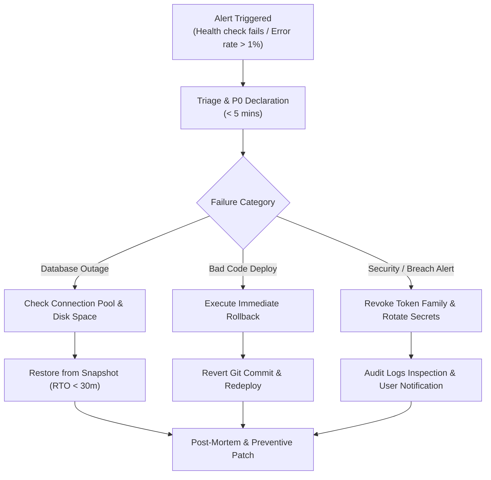

# DailySave Version 1.0.0 Release Documentation & Operational Runbook

**Release Version:** 1.0.0 (General Availability)  
**Release Date:** November 2026  
**Build Target:** Web (PWA), Android (APK/AAB), Native Node.js HTTP Server, PostgreSQL Database  
**Git Tag:** `v1.0.0`  

---

## 1. Release Overview & Summary of Changes

Version 1.0.0 marks the official production release of DailySave (የዕለት ቁጠባ). DailySave is an offline-first, multi-user personal and community finance platform tailored for the Ethiopian economic reality and emerging markets.

### Key Milestones Delivered in V1.0.0:
- **Clean Architecture Flutter Frontend:** 10 core feature modules (Dashboard, Transactions, Accounts, Savings, Budgets, Goals, Debts, Reports, Onboarding, Community).
- **Offline Persistence & Conflict Resolution:** Drift SQLite store with bi-directional sync engine (`/sync/push`, `/sync/pull`), idempotency tracking, and soft-delete tombstones.
- **Native Node.js HTTP Backend:** Zero-framework native HTTP microservices server using `node:http`, Argon2id password hashing, and token family rotation.
- **Multi-Tenant RBAC & Workspace Model:** 8 distinct role categories across Personal, Family, Business, and Community Equb workspaces.
- **Subscription & Entitlement System:** 5 configurable tiers (FREE, PLUS, FAMILY, BUSINESS, COMMUNITY) with feature entitlement gates.
- **Fictional Demo Mode & Onboarding Wizard:** 4-step accessible onboarding flow with pre-populated student, family, and merchant datasets without requiring real financial records.
- **WCAG 2.2 AA Compliance:** Screen-reader vocalization for currency, 48x48 dp minimum touch targets, high-contrast dark green palette (>4.5:1), and semantic trees.
- **Public SEO Marketing Website:** 21 static pages supporting English, Amharic, and Afaan Oromo with structured data, sitemaps, and robots.txt privacy exclusions.

---

## 2. Release Checklist Verification

| Domain | Verification Item | Status | Verification Evidence |
| :--- | :--- | :--- | :--- |
| **Codebase** | Code cleanliness and formatting | PASSED | `dart analyze` (0 errors), ESLint/Node clean |
| **Backend Tests** | Unit & integration test suites | PASSED | 58/58 tests passing (`node --test`) |
| **Frontend Tests**| Unit & widget accessibility suites | PASSED | 35/35 Flutter tests passing |
| **Accessibility** | WCAG 2.2 AA evaluation | PASSED | `docs/accessibility-audit-wcag22.md` |
| **Security** | Threat model, Argon2id, RBAC | PASSED | `docs/security-audit-and-reliability.md` |
| **SEO & Privacy**| Disallow `/` for dashboard, marketing indexed | PASSED | `node scripts/verify-production.js` (6/6 checks passed) |
| **Database** | 8 versioned migrations, 27 domain tables | PASSED | PostgreSQL schema verified |
| **Disaster Recovery**| Backup & restore automation scripts | PASSED | `backend/scripts/backup.sh`, `restore.sh` |
| **Beta Pipeline**| In-app & web feedback form | PASSED | `POST /api/v1/feedback`, `website/feedback.html` |
| **Documentation** | Audits, guides, marketing collateral | PASSED | 7 comprehensive markdown reports in `docs/` |

---

## 3. Deployment Instructions

### 3.1 Backend Deployment (Native Node.js on Render / VPS)
```bash
# 1. Clone repository
git clone https://github.com/your-org/dailysave.git
cd dailysave/backend

# 2. Install production dependencies
npm ci --omit=dev

# 3. Configure environment variables (.env)
cat << 'EOF' > .env
PORT=4000
NODE_ENV=production
DB_HOST=your-postgres-host.internal
DB_PORT=5432
DB_NAME=dailysave_db
DB_USER=dailysave_user
DB_PASSWORD=your_secure_db_password
DB_SSL=true
JWT_SECRET=your_minimum_32_character_jwt_secret_key
REFRESH_TOKEN_SECRET=your_minimum_32_character_refresh_token_secret_key
ALLOWED_ORIGINS=https://app.dailysave.et,https://www.dailysave.et
EOF

# 4. Run schema migrations
npm run migrate

# 5. Start the production server (or use systemd / PM2)
node src/server.js
```

### 3.2 Frontend Deployment (Cloudflare Pages)
```bash
# 1. Build Flutter Web for production
flutter build web --release --pwa-strategy=offline-first

# 2. Deploy output directory to Cloudflare Pages
# Build command: flutter build web --release
# Build output directory: build/web
# Root directory: /
```

### 3.3 Marketing Website Deployment (Cloudflare Pages)
- **Root Directory:** `website`
- **Build Command:** *(none, static HTML/CSS/JS)*
- **Output Directory:** `website`
- **Domain:** `www.dailysave.et`

---

## 4. Maintenance Guidelines & Runbook

### Routine Operational Tasks
1. **Daily Database Backups:** Run via cron job at 02:00 UTC using `backend/scripts/backup.sh`.
2. **Log Monitoring:** Inspect `backend` stdout logs for `[Slow Query Alert]` entries (>200ms) or rate-limit violations.
3. **SSL Certificate Expiration:** Automated via Cloudflare Edge TLS and Let's Encrypt renewal.
4. **Health Check Heartbeat:** Ping `GET https://api.dailysave.et/health` every 60 seconds.

---

## 5. Incident Response Procedure



### Severity Levels:
- **P0 (Critical Outage):** Core API unreachable, database corruption, or financial ledger calculation error. Immediate response within 15 minutes.
- **P1 (Degraded Performance):** Sync latency elevated (>2s) or intermittent payment/subscription webhook drops. Response within 1 hour.
- **P2 (Minor Issue):** Cosmetic UI flaw, translation typo, or non-blocking report rendering bug. Response in regular sprint.

### Rollback Plan:
If a newly deployed release exhibits unexpected regressions:
1. Revert to previous Docker image or Git commit:
   ```bash
   git revert HEAD --no-edit
   git push origin main
   ```
2. Cloudflare Pages rollback: Select previous deployment in Cloudflare Dashboard and click "Rollback to this deployment" (instantaneous).
3. If database schema was altered, apply down-migration scripts or restore the pre-deployment snapshot using `./backend/scripts/restore.sh`.
